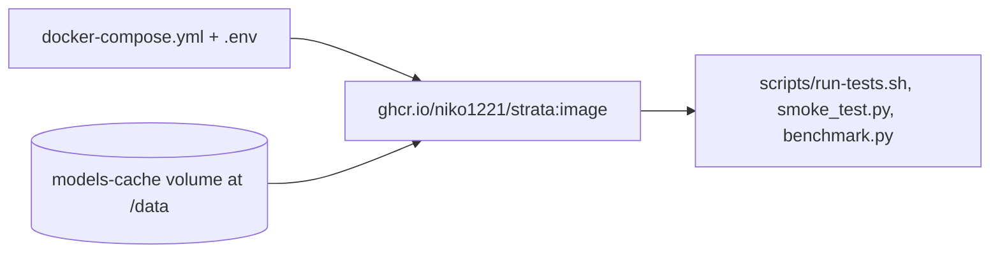

# model-runner-strata

Runs [Strata](https://github.com/Niko1221/Strata) on Linux in Docker: **Qwen3.8-Flash-Next** split across GPUs,
system RAM and SSD, with OpenAI- and Anthropic-compatible APIs on internal port `8080`.

Since Strata 0.2.x the engine ships as a signed prebuilt package inside upstream's image, so this repo is not a
build: it is the compose file, the settings mapping, a test gate and operator scripts.



## Requirements

- NVIDIA GPU(s), driver 580+ (the `cuda13` image), and the NVIDIA Container Toolkit
- 64 GB RAM for Q2_0 at 131K context on two cards
- ~150 GB free disk for a model plus its prepared pack

Tested on 2x RTX 3090 with 64 GB RAM at 131,072-token context.

## Run

```bash
cp .env.example .env                                   # optional; defaults match the file
docker network create ai-inference 2>/dev/null || true
docker compose --profile serve up -d strata            # first start downloads and prepares the model
./scripts/run-tests.sh                                 # upstream's tests + this repo's
```

The server is reachable only on the `ai-inference` network at `http://model-runner-strata:8080`.

**Authentication.** Beyond loopback a key is always on: set `STRATA_API_KEY` (16+ characters), or the first start
makes one and keeps it in the volume — show it with
`docker exec model-runner-strata strata launch --show-key --preset docker`. Every request then sends
`Authorization: Bearer <key>`; `GET /health` answers without one. With no key set, the server answers only Host
names in `STRATA_ALLOWED_HOSTS` (default `model-runner-strata`) plus localhost and IP addresses; anything else gets
`403`.

## Layout

| File | Role |
| --- | --- |
| `docker-compose.yml` | The one service: upstream's image, GPU reservation, RAM pinning, settings mapping |
| `.env.example` | Every setting with its default and why it matters |
| `scripts/run-tests.sh` | Runs upstream's server tests and this repo's tests inside the image |
| `scripts/smoke_test.py` | Scored end-to-end check of a running server |
| `scripts/benchmark.py` | Repeatable prompt/decode speed benchmark and a comparison between two runs |
| `scripts/test_smoke_test.py`, `scripts/test_benchmark.py` | Unit tests for the scoring in the two scripts above |

The container needs unlimited locked memory and `IPC_LOCK`, because Strata pins RAM for the GPU.

## Test

```bash
./scripts/run-tests.sh
docker exec -i model-runner-strata /opt/strata/terminal/python/bin/python3 - < scripts/smoke_test.py
docker exec -i model-runner-strata /opt/strata/terminal/python/bin/python3 - run < scripts/benchmark.py > after.json
python3 scripts/benchmark.py compare before.json after.json   # exit 1 when any speed drops more than 5 %
```

The smoke test prints `score: 3/3` when `/health` answers, a coding prompt returns code containing `def add`, and
server-side decoding reaches `STRATA_MIN_TOKENS_PER_SECOND` (default 20).

`run-tests.sh` runs 1,293 of upstream's server tests. Three of them error in the shipped image because the modules
they import (`test_strata_tokenizer`, `make_profile`, `web_i18n`) are not in it - that is upstream packaging, not a
problem with this setup.

## Choosing a model

Pick the size by how much of its **experts** fit in VRAM, not only by RAM. Experts that do not fit are streamed to
the GPUs for every 2,048-token prompt chunk, so on a slow host-to-GPU link prompt reading follows the share left in
RAM. Measured on 2x RTX 3090 over Thunderbolt (1.5 GB/s), IQ3_XXS kept 77 % of its experts in VRAM and read prompts
at 192-271 tok/s; Q2_0, whose experts nearly all fit, read 1,142 tok/s on a 15K-token prompt.

Sizes, downloads and RAM needs per model are in upstream's `docs/MODELS.md`.

## Two-GPU tuning

A layer split borrows expert-cache slots for its prompt buffers and streams the displaced experts from RAM on every
prompt, and the automatic split point can hand the second card more experts than it holds. Both cost the most on
cards behind a slow link. Two settings restore a split that keeps every expert in VRAM, both passed through
`STRATA_SET`:

| Setting | Effect |
| --- | --- |
| `STRATA_SPLIT_OWN=1` | Each card keeps its own prompt buffers (upstream default: borrow) |
| `layer_split=N` | First layer on the second card (upstream default: auto) |
| `STRATA_PREFILL_LAYER_MAJOR=0` | Read a prompt chunk by chunk instead of layer by layer across both cards |

The right split point depends on the cards, the link and the model. Measured on 2x RTX 3090 (prompt reading,
1.4K / 15K-token prompt):

| Model | Version | Split | Prompt reading (tok/s) |
| --- | --- | --- | --- |
| `coder` IQ1_M | 0.1.34 | 20 | 1,332-1,369 / 2,245 |
| `qwen` Q2_0 | 0.1.38 | auto (21) | 746 / 1,142 |
| `qwen` Q2_0 | 0.1.38 | 24 | 1,366 / 2,467 |
| `qwen` Q2_0 | 0.2.9 | auto (24) | 1,612 / 3,161 |

Since 0.2.7 a layer split reads a prompt layer by layer in pieces of up to 10,240 tokens (layer-major prefill, on by
default), so each layer's experts are read once per piece instead of once per 8,192 tokens. That is a big win when
experts are streaming from RAM. When every expert already sits on the cards it measured slower here: 1,992 tok/s on
a 15K prompt with it on, 3,161 tok/s with `STRATA_PREFILL_LAYER_MAJOR=0`.

`STRATA_PARALLEL` sets how many requests the engine answers at once (upstream chooses 3 for two cards). Slots each
take about 380 MiB of the expert cache. With every expert resident the difference is small - 1,612 / 3,161 tok/s at
3 slots against 1,690 / 3,160 tok/s at 1 - so leave it unset unless a benchmark says otherwise.

After any change, read the engine log's expert-cache line (it should say 100 % resident) and run the benchmark.

## Switching models

Change `STRATA_FAMILY` / `STRATA_MODEL` in `.env` and restart. The first start of a new model downloads and prepares
it; a download that is interrupted continues where it stopped on the next start. Model files already on the volume
are reused, so switching back is the same `.env` change.

```bash
docker compose --profile serve up -d strata
```

## Updating Strata

1. Set `STRATA_VERSION` in `.env` (the image tag) and restart.
2. Run `./scripts/run-tests.sh` first if the new version is not yet in use.
3. Run the smoke test and compare the benchmark against the previous version before keeping it.

Older settings that upstream dropped are warned about, not honoured: `LOW_RAM`, `RESIDENT_BUDGET_GIB`,
`KV_STREAMING`, `LAYER_SPLIT`, `CONFIG`, `REINSTALL`. Engine settings now go through `STRATA_SET`.

A volume from the 0.1.x image is picked up as it is: the first start moves `/data/models`, `/data/packs` and
`/data/mtp` into `/data/Strata-data` (a rename inside the volume, nothing copied or re-downloaded), and writes the
run settings again from the files that are there.
